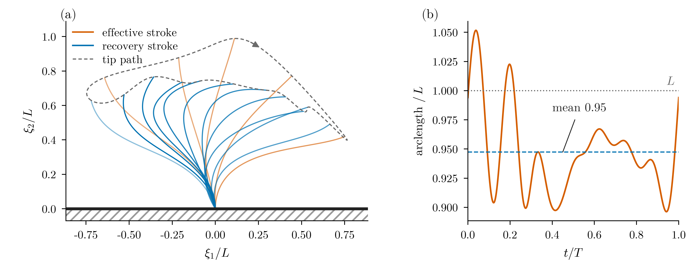

# cilia-nekrs

GPU simulation of flow driven by beating cilia, in [nekRS](https://github.com/Nek5000/nekRS) (v26).

<p align="center"></p>

Each cilium is an actuator filament: a chain of panels that follows a prescribed beat (Fulford & Blake 1986). The panels sample the fluid velocity, resistive-force theory turns the slip into a force, and that force goes back into the fluid as a regularised body force. Each filament's own flow is removed from the sampled velocity, and forces and flow are coupled implicitly within every time step by interface quasi-Newton iterations. The model lives in one udf (`3d.udf`); the force spreading is an OCCA kernel, so the same code runs on NVIDIA, AMD and Intel GPUs.

**The model is written up in [docs/model.pdf](docs/model.pdf)** (equations, kernels, coupling, the benchmark case and its verification).

The current focus is GPU performance and scaling toward very large numbers of cilia. v0.2 tuned the solvers (≈ 29× faster on the v0.1 model) and corrected the cilia model; v0.3 moves the cilia model onto the GPU so its cost grows linearly with the number of cilia (2.8% of the step at 256 cilia). **How each speed-up was made and what it bought: [docs/computational.md](docs/computational.md).**

## Quick start

You need a working nekRS v26 install (`nrsmpi` on your `PATH`), Python 3 with NumPy.

```bash
git clone https://github.com/waseemshameer/cilia-nekrs.git
cd cilia-nekrs/cases/small4
nrsmpi small4 1 | tee small4.log          # or: sbatch ../../job_template.sh small4
```

The first run JIT-compiles the kernels (several minutes); later runs reuse the cache. `small4.par` stops at t = 0.1. To check a change against the reference, set `endTime = 2.0` (two beat cycles, about a minute on one A100) and run

```bash
python3 ../../gate.py small4.log          # PASS if every quantity is within 0.1% of peak over cycle 2
```

## Contents

| Path | What |
|---|---|
| `3d.udf` | The cilia model: beat kinematics, RFT drag, self-flow removal, spreading kernel, IQN coupling, diagnostics |
| `cases/small4/` | Benchmark: 4 cilia in a periodic 1 × 1 × 1.5 box, 1,200 elements, N = 5 |
| `cases/tiled{2,4,8}/`, `cases/make_tiled.py` | `small4` tiled k × k: 16, 64, 256 cilia, for profiling at scale |
| `gate.py` | Regression gate against the `small4` reference run |
| `job_template.sh` | Generic Slurm script; adapt it to your cluster |
| `docs/` | [The model (PDF)](docs/model.pdf), [running](docs/running.md), [the case](docs/case.md), [performance](docs/performance.md), [computational work and speed-ups](docs/computational.md) |

## Citing and acknowledgements

See `CITATION.cff`. Released under the MIT license. The lab, colleagues and computing resources behind this work are acknowledged in [ACKNOWLEDGEMENTS.md](ACKNOWLEDGEMENTS.md).
