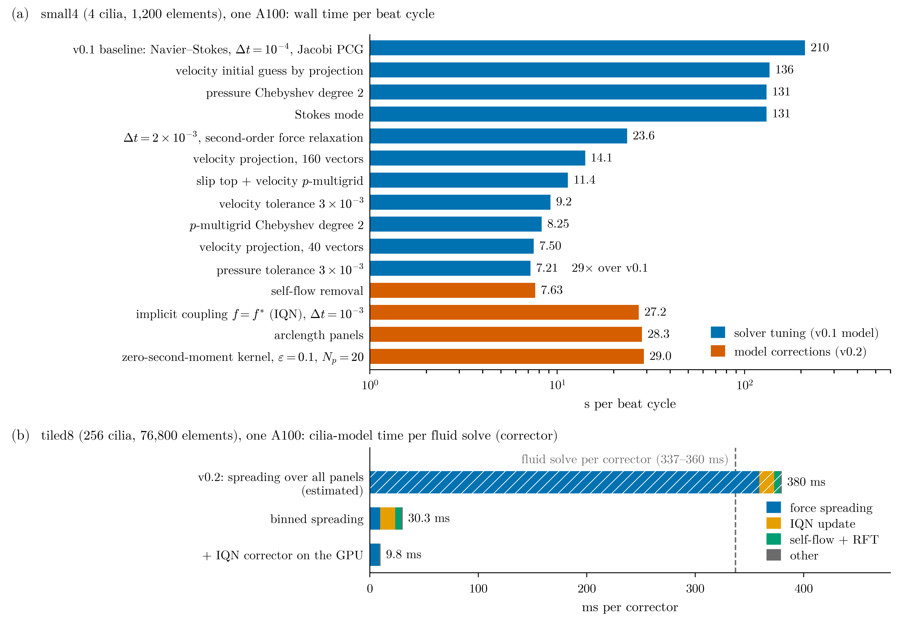

# Computational work: how the code got fast

This document explains how one time step is computed, what we changed to make it faster, and what each change bought. The model itself (equations, kernels, coupling) is in [model.pdf](model.pdf); the current numbers in short are in [performance.md](performance.md).

All timings are wall time on one NVIDIA A100 with one MPI rank, nekRS v26.0 `96b3cf9e`, polynomial order N = 5, and they stop at v0.3, which ran N_p = 20; production has since moved to N_p = 40. Runs were on different A100 nodes of the same cluster, which differ by a few percent; where a comparison needed better than that, both runs were on the same node.

Kernels stay in OCCA, which is vendor-neutral, though only the A100 has been run so far. Work goes in the udf and the par first. nekRS patches come only when profiling shows nekRS is the bottleneck.

**Figure.** (a) Wall time per beat cycle of the 4-cilium `small4` case after each change, in order. Solver tuning on the v0.1 model took 210 s to 7.2 s (29×). Correcting the model cost about 4× back, mostly because the implicit force–flow coupling needs two to three fluid solves per step and a smaller time step. (b) Time the cilia model takes per fluid solve on the 256-cilium `tiled8` case. Spreading the force over all panels would cost more than the fluid solve itself (estimated from its measured per-call time; the whole run was not done that way). Binning and moving the coupling update onto the GPU cut it about 39×, to 3% of the step.

## 1. What a time step does

The flow is Stokes flow in a periodic box above a no-slip wall, solved with nekRS's spectral-element solver. The cilia are actuator filaments: each cilium is a chain of N_p = 40 panels that follows a prescribed beat. Every time step:

1. **Kinematics.** Each panel's position, velocity and tangent at the new time come from the beat shape.
2. **Point location.** nekRS's `findpts` locates every panel centre in the mesh (element and local coordinates).
3. **Outer correctors** (2–5 per step), each of which:
   1. **Spreads** the current panel forces into a body force on the grid: every grid point sums a regularised kernel (radius ε, cut off at r_cut = 3.8 ε) over the panels near it.
   2. **Solves the fluid** (pressure, then velocity) with that body force.
   3. **Samples** the fluid velocity at the panel centres (`findpts` eval), subtracts each cilium's own regularised flow, and turns the slip velocity into a new panel force with resistive-force theory (RFT).
   4. **Updates the force** by interface quasi-Newton (IQN-ILS): a least-squares step built from the residuals of this and the previous steps' correctors. Stop when the force has converged (relative change below 3e-5).

The fluid solve is most of the cost when the number of cilia is small. As the number of cilia grows, steps 1, 2 and 3.1, 3.3, 3.4 grow with it, and step 3.1 grew with the product of grid points and panels, so it became the bottleneck at scale.

## 2. Test cases and how changes were judged

- **`small4`:** 4 cilia, 1,200 elements, 1 × 1 × 1.5 box. Small enough to run two beat cycles in about a minute; used for every solver change and as the regression gate.
- **`tiled2`, `tiled4`, `tiled8`:** the `small4` cell repeated k × k times (`cases/make_tiled.py`): 16, 64 and 256 cilia; 4,800, 19,200 and 76,800 elements. Used to measure how the cilia cost grows. `tiled2` reproduces `small4` per unit area (gate passes with `gate.py --per-area 4`), so the tiling is the same flow.

**Every change had to keep the answer.** `gate.py` compares mean flow, maximum velocity and wall integrals over the second beat cycle with a tight reference run; up to v0.3 a change passed if every quantity stayed within 0.1% of its peak. The current rule is in [running.md](running.md#regression-gate). New GPU code paths also have built-in checks that run the old path side by side for the first calls and print the difference (`binningCheck`, `iqnCheck`); they agree to round-off (≤ 1e-15 for forces, ≤ 1e-12 for the IQN update).

**Profiling.** `profileCilia = 1` (in `[CASEDATA]`) puts a device-synchronised timer around every part of the cilia model and prints them with nekRS's timer report. Off, it adds no synchronisation.

## 3. Stage 1: solver settings (v0.1 → v0.2, on the v0.1 model)

The first profile of `small4` (Navier–Stokes, dt = 1e-4, default solvers) found the fluid solvers at 88% of the time: velocity 70% (about 82 Jacobi-preconditioned CG iterations per step), pressure 18%, per-step diagnostics 5%, the cilia model only 2.4%. So the first stage was all solver settings, cheapest first. s/cycle is wall time per beat period.

| Change | Why it helps | s/cycle | step |
|---|---|---|---|
| v0.1 baseline: Navier–Stokes, dt = 1e-4, block CG + Jacobi | | 210 | |
| Velocity initial guess by projection onto previous solutions | the start guess is already close, so CG needs fewer iterations | 136 | 1.54× |
| Pressure Chebyshev smoother degree 2 | slightly cheaper multigrid cycle | 131 | 1.04× |
| Stokes mode (no advection) | the same cost per step, but no CFL limit on dt | 131 | 1.00× |
| dt = 2e-3, BDF2, Crank–Nicolson force relaxation | 20× fewer steps. The force filter's Euler update was a first-order dt error; Crank–Nicolson made the dt error second order, so a large step passes the gate | 23.6 | 5.6× |
| Velocity projection with 160 vectors | with 5 vectors the space kept filling and resetting at large dt; 218 → 78 iterations | 14.1 | 1.67× |
| Slip top boundary as an aligned `zeroDirichletZ` face, and velocity p-multigrid | p-multigrid needs the aligned face, which exposed a nekRS v26.0 bug, [#722](https://github.com/Nek5000/nekRS/issues/722) (averaged normals left empty on aligned slip faces, so the pressure boundary term blew up); `fixAlignedAvgNormals()` in the udf works around it | 11.4 | 1.24× |
| Velocity tolerance 1e-4 → 3e-3 | the gate quantities do not change | 9.2 | 1.25× |
| Velocity p-multigrid Chebyshev degree 2 | about 1.6 iterations left per component | 8.25 | 1.11× |
| Velocity projection back to 40 vectors | with a better preconditioner the large space costs more than it saves | 7.50 | 1.10× |
| Pressure tolerance 1e-4 → 3e-3 | 4.1 → 2.8 pressure iterations | **7.21** | 1.13× |

**Total: 29× on the same model.** Two smaller changes are not in the table because they matter for long runs rather than the two-cycle benchmark: the ten diagnostic reductions per step were fused into one device kernel (0.95 → 0.17 s per 1,000 steps), and checkpoints went from every 0.01 to every 0.1 time units.

Tried and rejected: a coarse-grid smoother and flexible CG for pressure (no gain), larger pressure projection spaces (the guess costs more than it saves), Chebyshev degree 3 and smaller projection spaces for velocity.

## 4. Stage 2: the corrected model (v0.2) costs about 4× back

The model was then corrected (details in [model.pdf](model.pdf)): each cilium's own flow is removed from the velocity it samples, and the force is coupled implicitly, f = f\*, inside every step instead of through a relaxation filter. The implicit coupling is what costs:

| Change | s/cycle |
|---|---|
| Stage 1 result | 7.21 |
| Self-flow removal | 7.63 |
| Implicit coupling (IQN outer correctors), dt 2e-3 → 1e-3 | 27.2 |
| Arclength panels | 28.3 |
| Zero-second-moment kernel, ε = 0.1, N_p = 20 | **29.0** |

The step count doubled (dt 1e-3: at 2e-3 the correctors needed 3.0 per step and the gate failed) and each step now does 2.3 fluid solves instead of one. At 2–3 solver iterations each, a corrector costs a fixed ~10 ms of right-hand side, projection and smoother work, so cutting correctors would be the lever on `small4`. Capping them at two, a looser time step and a stall-aware stop rule were all tried; none passed the gate (the larger time step would also have bought only 1.2×), so none was adopted.

## 5. Stage 3: the cilia model on the GPU at scale (v0.3)

With 4 cilia the model is a few percent of a step, so it had to be measured on the tiled cases. The v0.2 code did the cilia work like this:

- The force spreading kernel looped every grid point over **all** panels: cost ∝ grid points × panels, which grows as k⁴ with the tiling factor k.
- The IQN update (a QR factorisation of up to ~40 residual-difference columns of length 3 N_cilia N_p) and the self-flow subtraction (O(N_cilia N_p²) regularised Stokeslets) ran on the host, every corrector, with the forces copied between host and device each time.

Profile of the v0.2 code, ms per corrector:

| Case | cilia | spreading | self-flow | IQN update | cilia share of step |
|---|---|---|---|---|---|
| `tiled2` | 16 | 1.83 | 0.37 | 0.61 | 10% |
| `tiled4` | 64 | 22.8 | 1.40 | 4.2 | 22% |
| `tiled8` | 256 | 359 | 5.6 | 13.9 | ~50% (estimated) |

Spreading grew 12.5× for 4× the cilia, as expected for an all-pairs loop, and was ~90% of the cilia cost.

### 5.1 IQN robustness on large cases

Before the speed work, `tiled4` exposed a coupling failure: with the residual pairs of the last 8 steps kept (`couplingReuse = 8`), the correctors per step climbed near t ≈ 0.64 in the beat (where the forces change fastest), then every step hit the 50-corrector cap and the residual grew. Old pairs go stale when the Jacobian changes fast, and a failed step's bad pairs were reused by the next steps.

Fix: `couplingRestart = 10`. A step that needs 10 correctors drops the pairs of earlier steps and keeps only its own. On `tiled4` through the hard phase (670 steps):

| Setting | correctors/step | capped steps | s/step |
|---|---|---|---|
| reuse 8 (v0.2) | 5.57 | 22 | 1.59 |
| no reuse | 6.94 | 0 | 0.72 |
| reuse 4 | 3.97 | 0 | 0.46 |
| **reuse 8 + restart at 10** | **3.82** | **0** | **0.44** |

3.6× faster than v0.2 through that phase, with every setting agreeing on the mean flow to 3e-6.

Checked again on larger boxes at production solver tolerances (#9): with per-corrector output, `tiled8` (3 runs of 2,000 steps) and `tiled16` (1,000 steps, 16 GPUs) capped no step. Capped steps seen before (2 in an earlier `tiled16` run, 2 in an early `tiled8` run) didn't come back when the same case was rerun with the same settings, so they sit at round-off level. The long steps fall steadily to the tolerance, so a stop on stall would have nothing to catch. Steps of 10 or more correctors hold at most 4.4% of the correctors, so even a perfect rule would save under 1%. The setting stays. What grows with box size is the typical step (3.67 correctors/step on `tiled8`, 4.54 on `tiled16`, after the start-up).

### 5.2 Binned force spreading

Panels are sorted every step into uniform bins of about half r_cut, periodic in x and y (a stable counting sort, so the sum order and the result are deterministic). For each element, the bins within r_cut of its bounding box are found once at setup, since the mesh does not move. The kernel `addCiliaForceBinned` then loops each element only over the panels in those bins. The per-pair arithmetic is unchanged, so the force field equals the all-pairs result to round-off (≤ 6.4e-16 of the maximum force).

| Case | all pairs (ms) | binned (ms) | speed-up | per cilium |
|---|---|---|---|---|
| `tiled2`, 16 cilia | 1.83 | 0.55 | 3.3× | 34 µs |
| `tiled4`, 64 cilia | 22.8 | 2.17 | 10.5× | 34 µs |
| `tiled8`, 256 cilia | 359 | 9.54 | **37.6×** | 37 µs |

Spreading is now linear in the number of cilia. On `tiled8` the whole run is about 1.9× faster than it would be with the all-pairs loop, and the cilia model fell from ~50% to 7.5% of the step. A scatter layout (loop over panels, add into elements) was not needed and would need atomic adds with a non-deterministic sum order.

Found on the way: the panel coordinate buffers were allocated untyped, so nekRS's point search took their size in bytes as the point count and searched 8× too many points, reading past the end. Harmless on small cases; on `tiled8` it crashed. Now typed.

### 5.3 The IQN corrector on the GPU

After binning, the host IQN update (13.9 ms) and self-flow (5.6 ms) were the largest cilia costs on `tiled8`. Both moved to the device:

- **One panel kernel** (`ciliaPanelForce`, one thread per panel) takes the sampled velocity, subtracts the cilium's own regularised flow, and applies RFT. No host copy of the velocities.
- **The IQN iterate lives on the device.** The current force, residuals, the predictor history and all residual-difference pairs are slots of one device pool. Three kernels compute the residual, all the dot products a corrector needs in one launch (partial sums added on the host in a fixed order, so the result is deterministic), and the update.
- **QR → Gram matrix.** Instead of a modified Gram–Schmidt QR over vectors of 15,360 unknowns on the host, the code keeps the small Gram matrix G = ΔRᵀΔR, adding one row per corrector from the dot products above, and solves the least-squares problem by a Cholesky factorisation of G with the same column-dropping filter. That gives the same R factor as the QR, so the same columns are kept. Per corrector the cost goes from O(q² n) on the host to O(q n) on the device plus O(q³) on the host, with q ≤ ~40 columns and n = 15,360 unknowns.
- Forces come back to the host only at checkpoints.

`iqnCheck` runs the old host path alongside the first correctors: the panel force matches to 5e-16 and the IQN update to 9e-13, and the same columns are kept.

`tiled8`, 670 steps, ms per corrector unless noted:

| Part | binned (§5.2) | + device IQN | speed-up |
|---|---|---|---|
| IQN update | 13.9 | 0.11 | 122× |
| self-flow + RFT | 5.6 | 0.09 | 64× |
| velocity sampling (`findpts` eval) | 0.23 | 0.11 | 2.2× |
| force spreading | 9.54 | 8.66 | |
| reset of the body-force field | 0.5 | 0.46 | |
| kinematics + uploads (per step) | 1.4 | 1.51 | |
| point location (per step) | 0.47 | 0.34 | |
| **cilia model, total** | 97.5 s (**7.5%** of 1,293 s) | 30.4 s (**2.8%** of 1,100 s) | 3.2× |

The two runs were on different nodes, and the second needed fewer correctors (4.61 vs 4.81 per step, no capped step), so the solve totals differ by more than the cilia time. Force spreading is now 88% of what is left of the cilia cost. The fluid solve (0.34–0.36 s per corrector on `tiled8`) is again almost all of the step.

### 5.4 Where `tiled8` stands

| | v0.2 code (estimated) | v0.3 |
|---|---|---|
| s/step | ~3.6 | **1.64** |
| cilia share of the step | ~50% | **2.8%** |
| correctors per step | | 4.6 |
| capped steps in 670 | | 0 |

The v0.2 figure is the measured v0.3 run plus the measured extra cost of all-pairs spreading per corrector; v0.2's coupling setting (reuse 8 without restart) would likely also have hit the failure of §5.1. One beat cycle of `tiled8` takes about 27 minutes on one A100, and `tiled8` needs about 26 GB of host memory.

On `small4` (4 cilia) none of this shows: it runs at about 30 s per cycle, as in v0.2, because its cost is all in the fluid solve.

## 6. What is left

- **Per-step host work:** panel kinematics and binning are still built on the host and uploaded once per step, and the body-force field is reset from a saved copy every corrector. Together about 8% of the remaining cilia time on `tiled8` (0.2% of the step).
- **Multiple GPUs:** in v0.3 every rank holds every panel. From v0.4 each rank keeps only its own cilia plus a halo of those whose kernels reach its elements. Scaling work: [scaling.md](scaling.md).
- **Point location stays a full `findpts` search every step.** At N_p = 40 it costs 0.2–0.6 ms per step: 0.65% of the solve on `small4`, about 0.1% on `tiled8` on 4 GPUs. That's the ceiling on any saving, and less than A100 nodes differ. A starting guess would need a nekRS patch, since `findpts` has no input for one. Searching every k steps would sample at stale positions, so it would change results. Measured on at most 4 ranks on one node; recheck if `find` passes 1% of the solve at scale.
- **Coupling:** the corrector count (2.3 on `small4`, 4.6 on `tiled8`) multiplies the fluid cost, and the IQN settings still cap an occasional step on `tiled8` in some runs.
