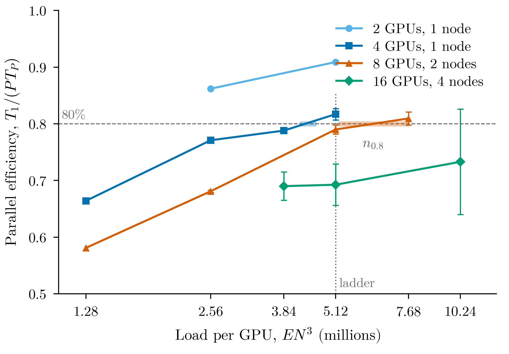

# Scaling: setup and evidence

What this project does about nekRS scaling on GPUs, and why. Every setting below was checked against the source of nekRS v26.0 `96b3cf9e` and our own timers. Source paths are relative to that commit. Abbreviated papers are listed at the end.

## Load per GPU

**Unit.** Load per GPU is E·N³, the developers' unit (Min25 Sec 1.1). It's close to the true unique count: `tiled8` has 9.76M unique points, E·N³ gives 9.60M, and E·(N+1)³ gives 16.6M.

**Rule.** The developers' 2–5M per GPU (Min25 Conclusions) is only a starting guess. Production is sized by our own measured n0.8, the load at which parallel efficiency falls to 80%. A value from 8 GPUs or fewer is labelled small-P and optimistic, because Min25 Sec 4 says n0.8 is smaller at small n and P, and that neighbour communication doesn't saturate until P > 26. No load at scale is quoted until a run has gone past that, or says how far it got.

**Ladder.** Scaling runs use the tiled cases at 64 tiles per GPU: 256 cilia, 40,960 elements, 5.12M E·N³. That's at or just under the small-P n0.8 measured below, the load production would run at ([cases](case.md#tiled-cases)).

**Measured.** Production mesh (8 × 8 × 10 per tile), N_p = 40, GPU-aware MPI on one node and across nodes, runs to t = 0.1, steps 11–99. The 16-GPU 5.12M point is steps 11–99 of the weak ladder's one-cycle run. These aren't release numbers; those are in [performance.md](performance.md). Efficiency is T₁ / (P · T_P) in seconds per coupling corrector, because the corrector count to t = 0.1 varies from run to run (417 to 523), so per step would mix solver work into the rank count. T₁ is the same case on 1 GPU where it fits, up to 15.36M (73 GB on one 80 GB A100). Above that, T₁ is the load times the 1-GPU rate, measured at 0.0531, 0.0521 and 0.0517 s per corrector per M E·N³ at 5.12M, 10.24M and 15.36M. The range takes that rate flat past 15.36M (upper) or still falling at its last measured slope (lower).

| GPUs | nodes | 1.28M | 2.56M | 3.84M | 5.12M | 7.68M | 10.24M |
|---|---|---|---|---|---|---|---|
| 2 | 1 | – | 0.862 | – | 0.909 | – | – |
| 4 | 1 | 0.664 | 0.771 | 0.788 | 0.807–0.827 | – | – |
| 8 | 2 | 0.581 | 0.679–0.683 | – | 0.782–0.798 | 0.798–0.821 | – |
| 16 | 4 | – | – | 0.665–0.715 | 0.656–0.729 | – | 0.640–0.826 |

Columns are E·N³ per GPU; elements per GPU are E·N³ / 125, from 10,240 at 1.28M to 81,920 at 10.24M. The 4-GPU 5.12M range also spans two nodes. On 16 GPUs every case is 61M E·N³ or more, so the T₁ range is wide: at 10.24M it's 0.64–0.83 from `tiled64x32` alone. `tiled32x24` from 8 to 16 GPUs is 0.870 against its own 8-GPU time, 0.4833 to 0.2777 s per corrector, with ū the same to 6e-7.

*Parallel efficiency against load per GPU, production mesh, on 2 to 16 A100s. Bars are the T₁ range where the case doesn't fit one GPU. The dashed line is 80%; the shaded spans on it are n0.8 for 4 and 8 GPUs. On 16 GPUs n0.8 is above 5.12M and has no upper bound yet. The dotted line is the scaling ladder's load.*

**Repeats.** On another node, `tiled16x8` on 1 and 4 GPUs repeats to 0.1% per corrector, with the same corrector count and ū; `tiled32x16` on 8 GPUs across two other nodes repeats to 0.4%. `tiled16` on 4 GPUs moved 1.9% with a different corrector count, so that run isn't bit-reproducible at 4 ranks. ū at t = 0.1 agrees across every run to 2e-6 relative.

**n0.8, small-P:** 4.2–4.6M per GPU on 4 A100 on one node, 5.2–7.7M on 8 A100 across two nodes, above 5.12M on 16 A100 across four nodes, and under 2.56M on 2 GPUs. Above about 4M per GPU the curve is flat (0.78–0.82), so n0.8 is a wide range on 8 GPUs even though each efficiency is tight. n0.8 rises with P, as Min25 Sec 4 says it does until P > 26, so no load at scale is quoted from these ([#16](https://github.com/waseemshameer/cilia-nekrs/issues/16), [#22](https://github.com/waseemshameer/cilia-nekrs/issues/22)). On 16 GPUs, 5.12M per GPU is 0.744 against the measured 1-GPU time at the same load (the weak ladder below), and 0.66–0.73 by T₁, so n0.8 is above it. The 10.24M range straddles 0.8, so it sets no upper bound. These studies stop at 16 GPUs for now, short of P = 26.

Efficiency depends on P as well as load: at 2.56M per GPU it's 0.86 on 2 GPUs, 0.77 on 4 and 0.68 on 8. The 1-GPU rate changes only 3% from 5.12M to 15.36M, so the loss is in communication, not on the GPU. The cilia code isn't the limit either: on the 10 × 10 × 12 mesh, `addCiliaForce` was 2.30% of the solve for `tiled8` on 4 GPUs with GPU-aware MPI.

**GPU-aware MPI.** `NEKRS_GPU_MPI=0` on a machine until a run there shows a gain and passes `gate.py` on cycle 2 between 1 and N GPUs: every gated metric, L2 ≤ 2e-4 and L∞ ≤ 2e-3 of peak. Off is the v26.0 default (`RELEASE.md:29`) and the developers' advice when the stack can't move device pointers (Discussions [#622](https://github.com/Nek5000/nekRS/discussions/622), [#578](https://github.com/Nek5000/nekRS/discussions/578), [#568](https://github.com/Nek5000/nekRS/discussions/568)). It's worth testing, since Polaris A100 n0.8 goes from 4.5M to 2.5M with it (Min25 Sec 5.3), but it can't be assumed: at 72,000 ranks on Frontier, routing through the host was the better option (Min25 Sec 5.5).

On our A100 machine it's on, on one node and across nodes. It needs Open MPI and UCX built with CUDA. On one node, `UCX_TLS=self,sm,cuda_copy,cuda_ipc`, and `tiled8` on 4 GPUs against 1 GPU passes: ū L2 1.59e-6, worst metric `int dv/dz` L2 3.2e-5 and L∞ 1.80e-4 of peak (10 × 10 × 12 mesh). On that mesh, each pair below ran on one node, on the same stack and `UCX_TLS`, and only `NEKRS_GPU_MPI` differs:

| Case | GPUs | E·N³ per GPU | host-staged, s/step | GPU-aware, s/step | change |
|---|---|---|---|---|---|
| `tiled8` | 2 | 4.8M | 1.620 | 1.494 | −7.8% |
| `tiled8` | 4 | 2.4M | 1.450 | 0.894 | −38.4% |
| `tiled4` | 4 | 0.6M | 0.495 | 0.273 | −44.8% |

Across nodes, `UCX_TLS` adds `gdr_copy,rc_x`, and UCX must be 1.18 or newer. UCX 1.16 doesn't find the NVIDIA peer-memory module on our nodes; it falls back to dma-buf, which the kernel rejects, and the run crashes in gather-scatter autotune. With UCX 1.18 the network cards read GPU memory directly (GPUDirect RDMA) and autotune picks device buffers. On the 10 × 10 × 12 mesh, `tiled8` on 8 GPUs across two nodes took 0.130 s per corrector GPU-aware against 0.203 host-staged, 1.56× faster. `tiled8` on 8 GPUs across two nodes passes the gate on cycle 2, per area against the reference (worst metric ∫dv/dz: L2 1.54e-4, L∞ 8.79e-4 of peak, against 1.57e-4 and 9.96e-4 on 4 GPUs on one node) and against that 4-GPU run directly (L2 3.9e-5, L∞ 4.0e-4).

This check replaces an earlier one, ū within 1e-6 at t = 0.1, which couldn't sort settings: on `tiled8` on 2 GPUs, both arms match to every printed digit and both miss it. The gate is looser, so a rank-dependent error inside its margins would pass. Two cycles don't exclude slower drift, and 2 GPUs have no cycle run.

**New advice.** Any new solver advice is checked against the v26.0 parser and our timers before use.

## Settings we keep

| Setting | Evidence |
|---|---|
| FP32 preconditioner, FP64 Krylov | `pfloat = float` is hard-coded (`src/platform/nekrsSys.hpp.in:21-31`), so it can't be turned off |
| Chebyshev+ASM, pressure | The default smoother; degree 2 gave 1.04× on `small4` ([computational.md](computational.md)) |
| Chebyshev+Jacobi, velocity | Degree 2 gave 1.11×; `src/core/elliptic/elliptic.cpp:469-475` requires a Jacobi smoother for velocity multigrid |
| BoomerAMG on the host | The v26.0 default (`doc/parHelp.txt:139-141`); the coarse grid is 3.5 s of about 148 s on 4 GPUs, host-staged |
| Default pMG schedule | Phi21 Sec 6: order and schedule move time only 10–20% |
| `pcg` non-block velocity | Required with multigrid (`src/core/elliptic/elliptic.cpp:463-467`); 14.2 to 11.4 s/cycle on `small4`. On `tiled8` on 4 GPUs, one node, `pcg` + Jacobi is 3.1× slower: 0.892 to 2.774 s/step ([#5](https://github.com/waseemshameer/cilia-nekrs/issues/5)). Across two nodes, `tiled16x8` on 8 GPUs, it's 3.07× slower per step, so multigrid's coarse-level messages cost nothing visible on the network ([#16](https://github.com/waseemshameer/cilia-nekrs/issues/16)) |
| Projection initial guess | 1.43× at the default 5 vectors, 23.6 to 14.1 s/cycle at 160; settled at 40 once velocity multigrid was in. On `tiled8` on 4 GPUs, one node, 20 vectors gives no gain: 0.892 to 0.906 s/step ([#5](https://github.com/waseemshameer/cilia-nekrs/issues/5)) |
| gs autotune (`OOGS_MODE` unset), comm overlap on | Min25 Sec 1.4; `src/platform/ogs/oogs.cpp:559`; `src/lib/nekrs.cpp:78` |
| `residualTol` 2e-3 velocity, 3e-3 pressure | 3e-3 for both passed the gate and was 1.25× for velocity and 1.13× for pressure against 1e-4. On the tiled cases, though, the inexact velocity solve adds coupling correctors in the hard phases of the beat. Velocity at 2e-3 takes `tiled8` on 4 GPUs from 4.41 to 3.68 correctors per step and 0.936× s/step, and still passes the gate (∫dv/dz L2 1.54e-4, L∞ 8.95e-4 of peak). 1e-3 cuts more correctors but each solve costs more: 0.973×. Tighter pressure doesn't cut correctors ([#18](https://github.com/waseemshameer/cilia-nekrs/issues/18)). The tolerance is scaled by √volume (`src/core/elliptic/elliptic.cpp:408`), so it means the same on any tile size |

## Weak scaling

The tiled ladder at 256 cilia (5.12M E·N³) per GPU, one beat cycle (1,000 steps), production settings, GPU-aware MPI, 4 GPUs per node ([#10](https://github.com/waseemshameer/cilia-nekrs/issues/10)). Cycle time is nekRS's `solve` timer. Setup is the rest: JIT load, mesh and partition. Cilia-cycles per GPU-hour = 256 × 3600 / time.

| Case | GPUs | nodes | s/step | correctors/step | s/corrector | efficiency per step | efficiency per corrector | cilia-cycles per GPU-hour, stepping / with setup |
|---|---|---|---|---|---|---|---|---|
| `tiled8` | 1 | 1 | 0.703 | 3.55 | 0.198 | 1.00 | 1.00 | 1311 / 1022 |
| `tiled16x8` | 2 | 1 | 0.834 | 3.90 | 0.214 | 0.84 | 0.93 | 1106 / 860 |
| `tiled16` | 4 | 1 | 0.983 | 4.11 | 0.239 | 0.72 | 0.83 | 938 / 761 |
| `tiled32x16` | 8 | 2 | 1.100 | 4.48 | 0.245 | 0.64 | 0.81 | 837 / 686 |
| `tiled32` | 16 | 4 | 1.271 | 4.83 | 0.263 | 0.55 | 0.75 | 725 / 611 |

No step hit the corrector cap. ū after one cycle agrees across all five to 1.5e-5 relative (2 GPUs is the worst; the rest are within 3.5e-6).

On 16 GPUs a cilium-cycle costs 1.8× what it does on one. About half of that loss is the solver: s/corrector rises 1.33×, as communication grows. The other half is more coupling correctors per step in the bigger boxes, 3.55 to 4.83, the same rise with box size as on the 10 × 10 × 12 mesh. Setup is 200–240 s at every size, so it costs more per cycle on one GPU (22%) than on 16 (16%).

Steps 11–99 of the 1- to 8-GPU runs agree with #16's strong-scaling runs of the same cases to 2% per corrector.

**How far it got:** 16 GPUs on 4 nodes. 32 and 64 GPUs aren't run: the studies are capped at 16 GPUs for now, so nothing here is quoted as a load at scale (P > 26).

## Advice we checked and didn't adopt

| Claim | Why not |
|---|---|
| A `.par` using `[PRESSURE]`, `[VELOCITY]`, `precPrecision`, `projectionType`, `projectionVectors`, `advection` or solver `fgmres` | Invalid for v26.0: the sections and keys don't exist in `src/platform/par/par.cpp`, and nekRS aborts on them |
| "15–25k elements per GPU" | In no developer source. On 4 GPUs on one node we measured 0.66 at 10,240, 0.77 at 20,480 and 0.79 at 30,720; n0.8 there is 33,600–36,800, and higher on more GPUs |
| "Under 5,000 elements stalls in BoomerAMG" | Our host-staged 0.29 at 4,800 fits "low efficiency", but Min25 Sec 2 puts the one-GPU limit on kernel-launch latency, and no source gives the BoomerAMG mechanism |
| "3–5× from projection" | The number has no support. Ours: 1.43× at the default, 1.67× at 160 vectors |
| "Coarse-grid allreduce dominates" | The coarse grid is 2.4% of our 4-GPU host-staged solve. This rejects the coarse-grid claim only: allreduce in PCG and projection is unmeasured |
| BoomerAMG on the device | The same host-staged 2.4%. Reopens only if the coarse grid passes 10% of the solve at scale, because below that even an instant coarse solve saves under 10% |
| Tolerances 1e-6 (pressure) and 1e-8 (velocity) | The gate passes at 2e-3 and 3e-3, and they're tighter than the developers' own 1e-4 and 1e-6 (Min25 Sec 2) |
| Whole-solver FP32, the `nekrs-fp32` binary (`CMakeLists.txt:155`, Discussion [#626](https://github.com/Nek5000/nekRS/discussions/626)) | It passes the gate on `small4`, but gains little: 7% with `solver = gmres+flexible+nvector=15` in `[FLUID PRESSURE]`, one run each, because the preconditioner is already float. Its default pressure solver, with iterative refinement, is 9% slower. Float kinematics error grows with t unless t is wrapped into one period. It uses 47% less device memory, but FP64 holds 122,880 elements (15.36M E·N³) in 73 GB on one 80 GB A100, three times the 80% load. Reopens if the 80% load nears GPU memory ([#4](https://github.com/waseemshameer/cilia-nekrs/issues/4)) |
| Explicit `pMGSchedule`, `[SCALAR01]`, ALE vs immersed boundary | The default schedule is fine, there's no scalar, and the case is already Eulerian |

## Sources

- **Min25:** Min, Lan, Fischer, Rathnayake, Holmen, "Nek5000/RS performance on advanced GPU architectures", *Front. High Perform. Comput.* 2 (2024), [doi:10.3389/fhpcp.2024.1303358](https://doi.org/10.3389/fhpcp.2024.1303358).
- **Phi21:** Phillips, Kerkemeier, Fischer, "Tuning spectral element preconditioners for parallel scalability on GPUs", [arXiv:2110.07663](https://arxiv.org/abs/2110.07663).
